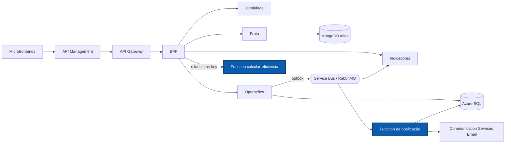

# NexFleet Function

Componente serverless do NexFleet em Azure Functions: calcula a eficiência da frota sob demanda e envia notificações por e-mail a cada abastecimento registrado.

[](https://github.com/mateusblm/nexfleet-function/actions/workflows/ci.yml)
[](https://hub.docker.com/r/mateusblm/nexfleet-function)


---

## Visão geral

O NexFleet é uma plataforma de gestão de frotas empresariais: veículos, motoristas, vínculos, abastecimentos, manutenções, painel de custos e uma visão consolidada de eficiência.

Esta Function App Java (`nexfleet-notificacoes`) tem dois papéis no produto:

- **`calcular-eficiencia`** (gatilho HTTP, sem estado e sem banco): o BFF envia o histórico de abastecimentos e manutenções de cada veículo ao montar o `GET /aggregated-data` e recebe consumo médio (km/l), custo por km e gastos, por veículo e da frota.
- **Notificação de abastecimento** (gatilho de evento): consome `AbastecimentoRegistrado` v1 publicado pela outbox de Operações, do **Azure Service Bus** ou do **RabbitMQ** local, registra a notificação de forma idempotente no **Azure SQL** (schema `notificacoes`) e envia o e-mail pelo Azure Communication Services.



## Funcionalidades

- Cálculo de distância, consumo médio, custo por km e gastos por veículo e da frota (média ponderada, não média das médias).
- Validação estrita da entrada: até 10.000 itens por requisição; JSON inválido, número negativo ou campo obrigatório ausente → `400` sem cálculo.
- Autenticação por chave da função (`authLevel = FUNCTION`).
- Correlação: `X-Correlation-ID` lido, registrado nos logs e devolvido (gerado se ausente ou inválido).
- Notificação de abastecimento idempotente: o mesmo evento não gera dois registros.
- E-mail pelo Azure Communication Services com identidade gerenciada; localmente, o e-mail é apenas capturado no banco.
- Gatilhos de evento para os dois transportes do produto: Service Bus (`NotificarAbastecimentoServiceBus`) e RabbitMQ (`NotificarAbastecimentoRabbit`).

## Arquitetura

**Clean Architecture + Vertical Slice.** Cada caso de uso é uma fatia em `br.com.nexfleet.notificacoes`; a camada `api` contém os gatilhos do Azure Functions.

| Fatia | Camadas | Responsabilidade |
|---|---|---|
| `calculareficiencia` | `api`, `application`, `domain` | Gatilho HTTP, validação e cálculo de eficiência |
| `notificarabastecimento` | `api`, `application`, `infrastructure` | Gatilhos de evento, idempotência, persistência e envio de e-mail |

Pacote técnico: `config` (raiz de composição das dependências, sem framework de injeção).

Regras verificadas pelo ArchUnit (`ArchitectureTest`):

- `application` não depende de framework nem de adaptadores;
- `domain` não depende de framework nem de outras camadas;
- a entrada (`api`) não acessa a persistência diretamente;
- adaptadores (`infrastructure`) não dependem da entrada.

## API

| Método | Rota | Descrição |
|---|---|---|
| `POST` | `/api/calcular-eficiencia` | Eficiência por veículo e da frota (chave da função obrigatória) |

| Gatilho | Origem | Descrição |
|---|---|---|
| `NotificarAbastecimentoServiceBus` | Tópico `nexfleet-eventos-v1`, assinatura `notificacoes-abastecimentos-v1` | Notificação de abastecimento (nuvem) |
| `NotificarAbastecimentoRabbit` | Fila `nexfleet.notificacoes.abastecimentos.v1` | Notificação de abastecimento (local) |

A Function não é exposta pelo API Management: só o BFF a chama, e o resultado aparece no campo `eficiencia` de `GET /aggregated-data`, documentado na [Swagger UI em produção](https://apim-nexfleet-homolog-ukzjodf42myfe.azure-api.net/swagger-ui.html) (seletor "BFF").

### `POST /api/calcular-eficiencia`

Contrato completo em [docs/calcular-eficiencia.md](docs/calcular-eficiencia.md).

- **Autenticação:** chave da função no cabeçalho `x-functions-key` (ou `?code=`); sem chave válida o runtime responde `401`.
- **Content-Type:** `application/json`.

Requisição:

```json
{
  "veiculos": [
    {
      "veiculoId": "00000000-0000-0000-0000-00000000000a",
      "placa": "ABC1D23",
      "abastecimentos": [
        { "data": "2026-10-01T10:00:00Z", "litros": 40, "valor": 200.00, "quilometragem": 10000 },
        { "data": "2026-10-20T10:00:00Z", "litros": 50, "valor": 250.50, "quilometragem": 10500 }
      ],
      "manutencoes": [ { "valor": 99.25 } ]
    }
  ]
}
```

Resposta `200` (resumida):

```json
{
  "veiculos": [
    {
      "veiculoId": "00000000-0000-0000-0000-00000000000a",
      "placa": "ABC1D23",
      "consumoMedioKmL": 10.00,
      "custoPorKm": 1.10,
      "gastoAbastecimento": 450.50,
      "gastoManutencao": 99.25,
      "gastoTotal": 549.75,
      "distanciaKm": 500
    }
  ],
  "frota": { "consumoMedioKmL": 10.00, "custoPorKm": 1.10, "gastoTotal": 549.75, "distanciaKm": 500 }
}
```

Regras principais:

- `distanciaKm` = km máximo − km mínimo dos abastecimentos do veículo;
- `consumoMedioKmL` = distância / litros dos abastecimentos **posteriores ao primeiro** (o primeiro marca o tanque cheio de partida);
- `custoPorKm` = `gastoTotal` / distância;
- com menos de dois abastecimentos ou distância 0, `consumoMedioKmL` e `custoPorKm` vêm `null` (os gastos são calculados);
- na frota, consumo e custo por km consideram só veículos com distância > 0; `gastoTotal` soma todos;
- arredondamento com 2 casas decimais, `HALF_EVEN`.

| Status | Quando |
|---|---|
| `200` | Cálculo realizado |
| `400` | JSON malformado, corpo ausente, tipo inválido, campo obrigatório ausente, número negativo ou mais de 10.000 itens; corpo `{ "erro": "<motivo>" }` |
| `401` | Chave da função ausente ou inválida |

## Stack

| Camada | Tecnologia | Versão |
|---|---|---|
| Linguagem | Java | 21 |
| Runtime | Azure Functions (extension bundle `[4.0.0, 5.0.0)`) | 4 |
| Biblioteca | `azure-functions-java-library` | 3.2.3 |
| Gatilho RabbitMQ | `azure-functions-java-library-rabbitmq` | 2.0.0 |
| Empacotamento | `azure-functions-maven-plugin` | 1.38.0 |
| SDK Azure | Azure SDK BOM (`azure-communication-email`, `azure-identity`) | 1.3.9 |
| Banco de dados | Azure SQL / SQL Server (`mssql-jdbc`), HikariCP | 13.4.0 / 7.0.2 |
| Migrações | Flyway (`flyway-sqlserver`) | 12.4.0 |
| JSON | Jackson | 2.20.0 |
| Testes | JUnit 5, AssertJ, Testcontainers (SQL Server), ArchUnit | 5.13.4 / 3.27.6 / 2.0.5 / 1.4.1 |
| Build | Maven Wrapper | 3.9.16 |
| Contêiner (execução local) | `mcr.microsoft.com/azure-functions/java:4-java21` | 4 |
| CI/CD | GitHub Actions → Docker Hub | — |

## Primeiros passos

### Pré-requisitos

- JDK 21 (o Maven vem pelo wrapper `./mvnw`)
- Docker, para os testes de integração (Testcontainers) e para executar a imagem

### Testes

```bash
./mvnw -B -ntp verify
```

### Executar com Docker

A imagem serve para execução local; na Azure a Function é implantada por pacote. O gatilho HTTP não usa banco, mas a Function App também carrega os gatilhos de notificação, que exigem SQL Server com o schema `notificacoes` migrado, armazenamento (Azurite) e RabbitMQ:

```bash
docker run --rm -p 7071:80 \
  -e FUNCTIONS_WORKER_RUNTIME=java \
  -e AzureWebJobsStorage="<connection-string-do-azurite>" \
  -e AzureWebJobs.NotificarAbastecimentoServiceBus.Disabled=true \
  -e RabbitMqConnection="amqp://<usuário>:<senha>@<host>:5672" \
  -e DB_URL="jdbc:sqlserver://<host>:1433;databaseName=<banco>;encrypt=true" \
  -e DB_USER=<usuário> \
  -e DB_PASSWORD=<senha> \
  mateusblm/nexfleet-function:v1.0.0
```

O ambiente completo abaixo já faz tudo isso (Azurite, migrações e chaves da função).

Para gerar a imagem a partir do código: `docker build -t mateusblm/nexfleet-function:local .`

### Ambiente completo

O produto inteiro (todos os serviços, SQL Server, MongoDB, RabbitMQ e Azurite) sobe pelo repositório [nexfleet](https://github.com/mateusblm/nexfleet):

```bash
git clone https://github.com/mateusblm/nexfleet.git && cd nexfleet
scripts/clonar-tudo.sh                                        # clona os demais repositórios ao lado
scripts/iniciar-local.sh                                      # gera o .env e a chave RSA local
docker compose -f compose.yaml -f compose.build.yaml up -d --build
scripts/seed-demo.sh                                          # dados de demonstração
```

## Configuração

| Variável | Descrição | Padrão |
|---|---|---|
| `FUNCTIONS_WORKER_RUNTIME` | Runtime de linguagem; deve ser `java` | obrigatória |
| `AzureWebJobsStorage` | Armazenamento do host do Azure Functions; contém credenciais | obrigatória |
| `DB_URL` | URL JDBC do SQL Server / Azure SQL (notificações) | obrigatória |
| `DB_USER` | Usuário de banco do schema `notificacoes` | obrigatória |
| `DB_PASSWORD` | Senha do usuário de banco; segredo | obrigatória |
| `EMAIL_PROVIDER` | `azure-communication` envia e-mail; outro valor só captura no banco | `captured-local` |
| `AZURE_COMMUNICATION_EMAIL_ENDPOINT` | Endpoint do Communication Services (com `azure-communication`) | — |
| `EMAIL_SENDER_ADDRESS` | Remetente (com `azure-communication`) | — |
| `EMAIL_RECIPIENT_ADDRESS` | Destinatário (com `azure-communication`) | — |
| `NexFleetServiceBus__fullyQualifiedNamespace` | Namespace do Service Bus (identidade gerenciada) | — |
| `RabbitMqConnection` | Conexão AMQP do RabbitMQ (local); contém credenciais | — |

No ambiente local do repositório `nexfleet`, `EFICIENCIA_FUNCTION_KEY` e `FUNCTION_MASTER_KEY` definem as chaves da função.

## Ambiente em nuvem

| Recurso | Endereço |
|---|---|
| Aplicação | https://white-mushroom-0cadda010.3.azurestaticapps.net |
| API (Azure API Management) | https://apim-nexfleet-homolog-ukzjodf42myfe.azure-api.net |
| Visão consolidada (com token) | https://apim-nexfleet-homolog-ukzjodf42myfe.azure-api.net/aggregated-data |
| Swagger UI | https://apim-nexfleet-homolog-ukzjodf42myfe.azure-api.net/swagger-ui.html |
| AsyncAPI dos eventos | https://white-mushroom-0cadda010.3.azurestaticapps.net/docs/eventos/ |
| Imagem Docker (execução local) | https://hub.docker.com/r/mateusblm/nexfleet-function |

Na nuvem, a Function roda em Azure Functions (Flex Consumption), implantada por pacote, sem exposição pública: só o BFF a chama, com a chave da função.

> Os serviços escalam a zero quando ociosos. A primeira requisição após um período de inatividade pode levar de 1 a 2 minutos.

## Testes

| Tipo | Exemplos | O que cobre |
|---|---|---|
| Unitários | `CalcularEficienciaTest`, `CalcularEficienciaValidacaoTest`, `NotificarAbastecimentoTest` | Regras de cálculo, validação de entrada e notificação idempotente |
| Gatilhos | `CalcularEficienciaFunctionTest`, `NotificarAbastecimentoFunctionTest` | Respostas HTTP, correlação e processamento de eventos |
| Integração (Testcontainers, SQL Server) | `MigracaoSqlServerIT`, `JdbcProvedorEmailCapturadoIT` | Migração do schema e captura de e-mail em SQL Server real |
| Arquitetura (ArchUnit) | `ArchitectureTest` | Dependências entre camadas |

```bash
./mvnw -B -ntp verify     # testes de integração exigem Docker
```

O CI (`.github/workflows/ci.yml`) executa `verify` a cada push e pull request; em tags `v*`, publica `mateusblm/nexfleet-function:<tag>` e `:latest` no Docker Hub.

## Equipe

- Vinícius dos Reis Góes
- Mateus Burlamaqui
- Lucas Roussenq
- Erik Carvalho
